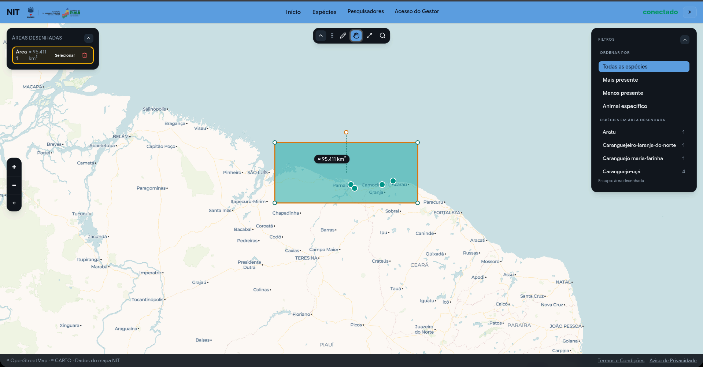
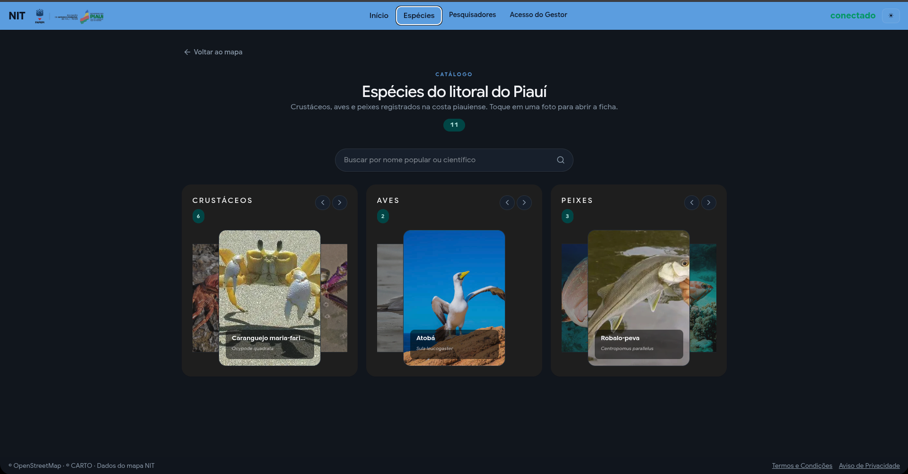

# NIT

Dashboard informativo em mapa sobre espécies litorâneas, com área de
pesquisadores credenciados para submissão de resultados (`.xlsx`, `.csv` e
outros formatos). Projeto do Governo do Estado do Piauí, em parceria com a
FAPEPI e universidades, reunindo áreas diversas — biologia, engenharia de
pesca, pesquisadores e cursos de TIC.

## Visão geral

- **O que é:** plataforma pública de visualização geoespacial de dados sobre
  espécies litorâneas + portal onde pesquisadores se credenciam e submetem
  resultados de pesquisa.
- **Quem faz:** parceria FAPEPI + universidades (biológicas, eng. pesca, TIC).
- **De quem é:** Governo do Estado do Piauí.

## Arquitetura

Django só-API + React SPA desacoplados (decisão B). Detalhes e justificativa:
[`docs/ARQUITETURA.md`](docs/ARQUITETURA.md).

## Desenvolvimento (loop engineering)

O desenvolvimento é guiado por specs e 3 gates por implementação
(funcional, desempenho, coerência). Ver [`GUIA_LOOP.md`](GUIA_LOOP.md) e
[`AGENTS.md`](AGENTS.md).

Acompanhamento: [Kanban do NIT — Status do Projeto](https://trello.com/b/Y46Sxmy3/kanban-do-nit-status-do-projeto).

## Layout (alvo, monorepo)

- `backend/` — Django API 
- `frontend/` — React + Vite SPA 
- `loop/` — specs, scripts e gates do loop
- `docs/` — decisões de arquitetura e referências

## Aparência Atual :



### Grid de especies implementado :



## Como baixar e testar :

### Baixe todo o conteúdo do repositório via git:
```bash
Git pull https://github.com/Henzo-Hanz/NIT.git
```
### entre no backend:
```bash
cd backend/
```
### Baixe as dependências, sincronize com o repositório e rode o servidor local do backend:
```bash
uv sync && uv run manage.py run server
```

### Após rodar o comando anterior com sucesso vá para a pasta do frontend:
```bash
cd .. && cd frontend/
```

### instale as dependências do frontend:
```bash
npm i  #install implícito
```
### crie sua chave para a API de OpenStreetMap no Carto:
vá em [Get your api key](https://carto.com/basemaps/apikey/) para criar sua chave de api e salve em `.env.local` para o mapa funcionar corretamente.

```bash
touch .env.local && echo VITE_CARTO_API_KEY=YOUR_CARTO_API_KEY && tee -a .env.local  # if is a unix like system

# if is in windows just do "echo VITE_CARTO_API_KEY=YOUR_CARTO_API_KEY > env.local"   
```

### agora suba o servidor localmente :
```bash
npm run dev # irá abrir no localhost:5173/ só abrir no navegador e tudo estará funcionando como deveria

# se quiser que todos na rede possam testar o projeto use com o argumento -- --host:
npm run dev -- --host
# e ele irá mostrar o ip disponível para todos na rede acessem pelo navegador
```

# _Prontinho! Você ja pode testar o nosso projeto!_ 🎉

